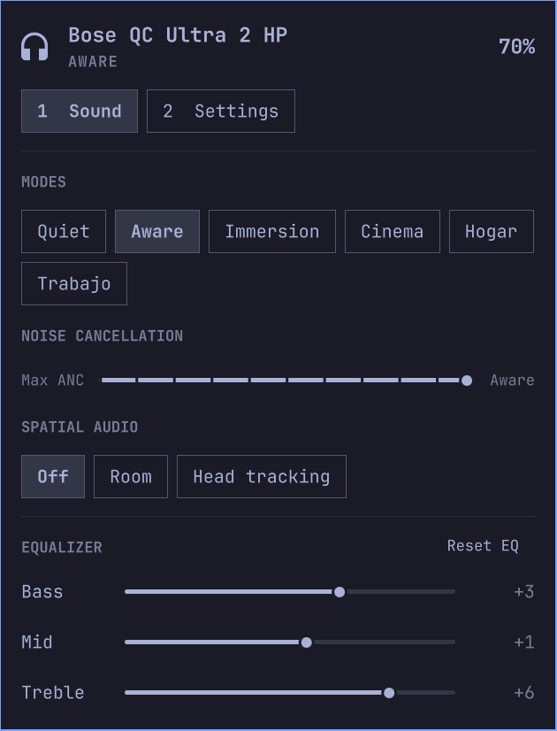

# Bose QC Ultra for Omarchy

Bar widget for Bose QuietComfort Ultra headphones. Battery and a panel with modes
(including your own profiles), noise cancellation level, spatial audio, a 3-band EQ,
wind block, multipoint, auto pause, auto answer, voice prompts, self voice and the
shortcut button. No phone app and no account.

> **Status.** Developed on the QC Ultra Headphones (2nd gen). Reading the state, switching
> modes and the multipoint toggle are verified on hardware; the other controls use the same
> protocol calls but have had less testing. Unofficial, not affiliated with Bose.

## Requirements

- Omarchy (Quickshell shell) and `python3`.
- Headphones paired and connected with BlueZ.

## Install

    omarchy plugin add https://github.com/borferkic/bose-omarchy --enable

then add the widget to your bar, or run `omarchy bar move io.github.borferkic.bose --section right`.
The shell may need `omarchy restart shell` once.

## Usage

| Input | Action |
| --- | --- |
| Left click on the bar icon | Open the panel |
| Right click | Refresh |
| `Esc` / `r` / `1` / `2` | Close / refresh / Sound tab / Settings tab |

The headphones accept one BMAP client at a time, so the widget opens a short session per
action. If the Bose app on your phone holds the link, the panel says the headphones are busy.
It reads the battery every 5 minutes while closed (setting `pollMinutes`).

## How it works

`bin/bosejson.py` is a JSON front end to a bundled copy of
[pybmap](https://github.com/aaronsb/bosectl) (MIT, `LICENSE.pybmap`) that speaks the Bose
BMAP protocol over Bluetooth RFCOMM. The bundled copy fixes the multipoint flag (bit 0 is
"enabled", bit 1 is "supported"). Nothing is sent to the network.

## Uninstall

    omarchy plugin remove io.github.borferkic.bose

and remove `{ "id": "io.github.borferkic.bose" }` from `shell.json` if it is still there.

## License

MIT. See `LICENSE`; `lib/pybmap` is MIT as well (`LICENSE.pybmap`).
